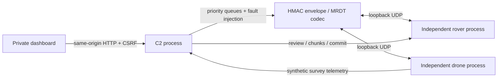

# Architecture

The initially selected repository contained only a README. The owner clarified that no prior Comms2027 implementation existed and authorized building from Missouri's software. This implementation reuses the MIT-licensed MRDT C++ packet codec at runtime, then adds application-level reliability and URC-specific simulation policy. It does not import unlicensed Python/Base implementations or pretend to preserve pre-existing application code.

## Runtime boundaries

`comms.supervisor` starts three Python processes, each independently replaceable. The rover owns position, mode, local control lease, route execution, received packages and activation. The drone owns flight state and synthetic product generation. C2 owns operator requests, acknowledgement tracking, UI snapshots, transfer scheduling and fault injection. The UI never changes confirmed vehicle state optimistically.

All datagrams are serialized/deserialized through the vendored native MRDT codec. A checked C ABI prevents the upstream decoder from seeing inconsistent lengths/types/counts. The application envelope uses HMAC-SHA256 with a generated 32-byte key in a mode-0600 local file. Native source hashes are verified before every build. Authentication here is a development boundary; no radio security/certificate/key provisioning integration is claimed.

Default ports are HTTP 8080, C2 UDP 12050, rover UDP 12051, drone UDP 12052. Every listener binds localhost. Only HTTP 8080 is configured for private Codespaces forwarding. HTTP accepts exact local or platform-derived forwarded Hosts, checks same-origin requests, requires a CSRF token and JSON content type for mutations, and limits body size and handler concurrency. Codespaces provides external user authentication; the local HTTP application does not replace it. Never make the forwarded port public.

## Historical satellite views

The browser's field map and separate drone position map use bundled, licensed 2016 Sentinel-2 tiles. `web/geoview.js` projects WGS 84 telemetry and reviewed routes onto their actual Web Mercator tile coordinates; it never fits a route to the image. Source metadata and tile SHA-256 hashes are verified offline by `scripts/fetch_imagery.py --verify`. C2 exposes only the manifest and constrained tile filenames, with same-origin image policy and no remote image proxy. Missing imagery leaves telemetry and command handling available. The camera tab is explicitly disconnected; the drone position map is historical satellite imagery, not camera video. See [imagery provenance](imagery-source.md).

## Command authority and reconnection

Each vehicle issues random short-lived command-window tokens. It expires them using its own monotonic clock. C2 echoes a token alongside the vehicle boot identity, C2 session, command ID and sequence. No independent monotonic clocks are compared. Strict receiver sequencing prevents reordered motion commands; a fresh software STOP remains effective even when overtaken by a newer sequence.

Manual authority is a separate receiver-local 0.8-second lease. A pulse requires that lease and does not renew it. Onboard autonomous routes do not require a continuously connected C2 link, because the rules explicitly include loss of line of sight. A C2 session replacement cancels motion and reconciles the current state; restarting either vehicle starts a fresh stopped simulation. Reconnecting the same live session does not resume a stopped route. If a route continued during a radio outage, C2 reports that continuing state rather than claiming it had stopped.

Completion comes only from a matching vehicle/boot/session/command acknowledgement. The receiver retains a bounded result cache. C2 polls accepted commands by retransmitting the same ID without changing its original window or arguments; this retrieves the final cached ACK without repeating execution. Fixed deadlines and retry caps prevent indefinite retry traffic.

## Packages and synthetic navigation

The drone generates a small explicitly synthetic WGS 84 waypoint product. C2 presents it for operator review and can also review an uploaded package using the same strict schema. Transfers are chunked and bounded, with whole-package SHA-256, immutable IDs/versions, resumable missing-chunk state, and duplicate-chunk checking. A package becomes validated only after complete integrity/schema checks. Activation and route start are separate explicit commands; package mutation and activation require a stopped rover.

Route execution advances through synthetic points on the rover's clock. There is no sensor model, collision detection, obstacle avoidance, path interpolation safety, LiDAR, DEM processing or real terrain planner. Recovery returns through visited points. Arbitrary manual control is blocked in route finding and astronaut assistance; the fuller rule-permitted explored-area manual recovery remains an adapter/planning gap. The dashboard locks new package inputs during autonomous motion or stale telemetry, following official Autonomy Q&A 21; existing data can still be inspected read-only.

Before route departure, rover requires a fresh authenticated report that the drone is landed at its designated pad and flight-locked. Both vehicles must be in the route-finding phase. Leaving the drone lock requires fresh rover phase evidence. These conservative simulation guards exercise the workflow; physical flight status and field safety still require trustworthy flight-controller integration.

## Priority, memory and process lifecycle

The scheduler has separate priority queues: STOP; command/ACK; telemetry; bulk. Caps are 128, 128, 128 and 64 queued items. Delivery favors essential traffic among due frames and is limited to 32 deliveries per loop. Ingress processing is capped per iteration. Normal pending commands stop at 56, with safety/session requests allowed up to 64 and preemption when necessary. Histories contain at most 256 commands/events.

The receiver permits two pending transfers (each at most 64 KiB), four validated packages, 128 chunks per package, 2 KiB per chunk and 128 waypoints. C2 permits four active transfers with eight retained transfer results. These are development limits, not radio throughput measurements. No video implementation competes for these queues.

Package and vehicle state is volatile by design: restarting a vehicle clears it and changes the boot identity. The runtime key and logs persist locally; running processes do not persist across cloud environment publication/restoration. The supervisor restarts failed children at most three times per 30-second window before failing visibly. A new task must run the start command again.

## Deployment boundaries

The same source builds and runs offline on a prepared Linux laptop. A separate vehicle-computer/radio transport adapter must preserve the session/expiry semantics, validate the selected board manifest, supply independently authenticated peer identities and keep bulk/media traffic subordinate to control. See `hardware-gaps.md`. No physical deployment or hosted Codespace was exercised in this task.
